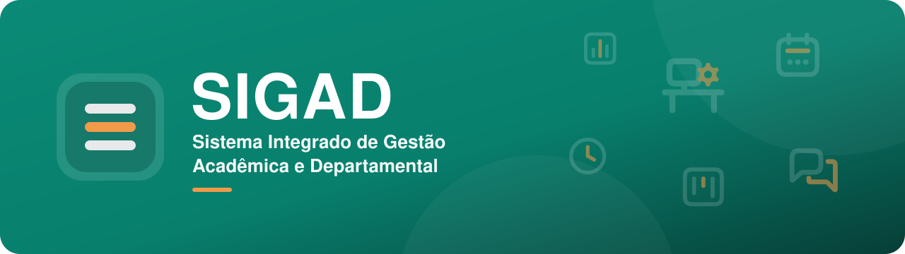
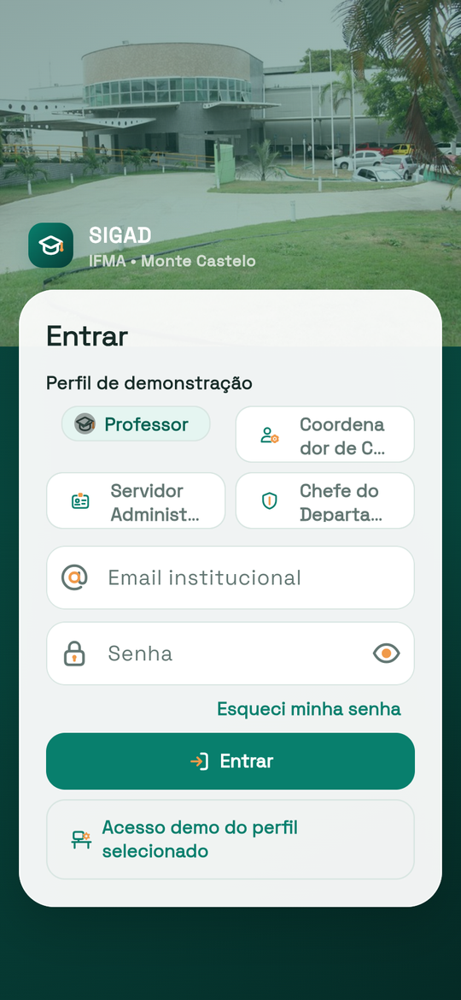
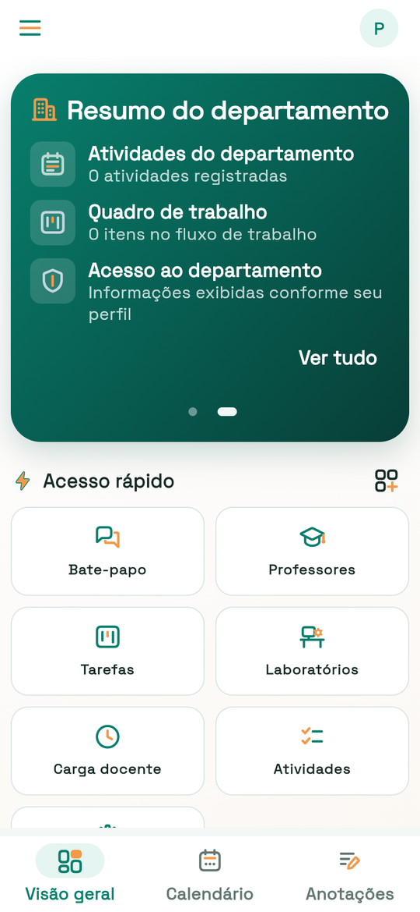
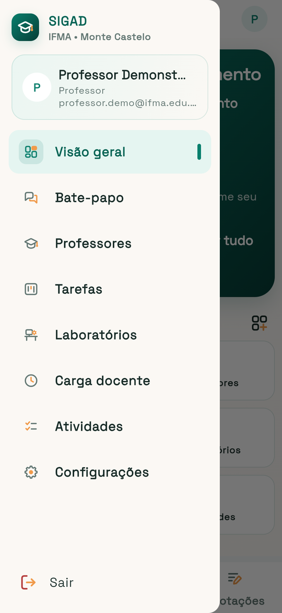
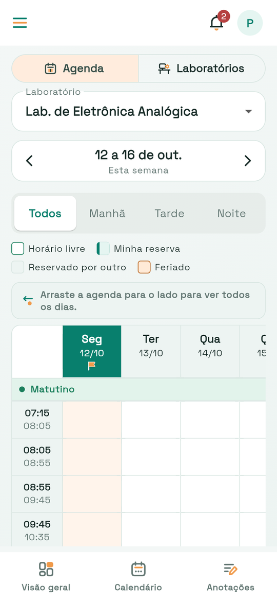
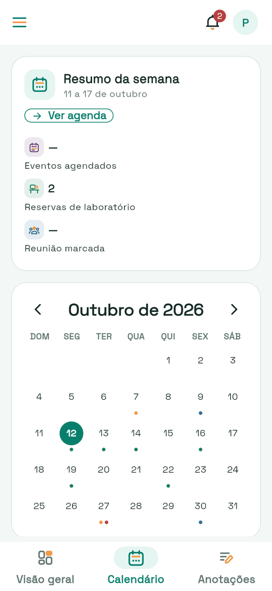

<div align="center">



<br>

[](https://github.com/frahncky/SIGAD/actions/workflows/ci.yml)
[](https://github.com/frahncky/SIGAD/actions/workflows/quality-gate.yml)


**Aplicativo do IFMA para o dia a dia acadêmico e departamental:**<br>
demandas, laboratórios, agenda, carga docente, atividades e comunicação em um só lugar.

[Funcionalidades](#-funcionalidades) ·
[Telas](#-telas) ·
[Como executar](#-como-executar) ·
[Arquitetura](#-arquitetura) ·
[Documentação](#-documentação)

</div>

---

## ✨ Sobre

O **SIGAD** é um aplicativo Flutter responsivo para os perfis institucionais do IFMA, como professores, coordenação, chefia de departamento e apoio administrativo. Cada perfil vê um painel e um menu próprios, com os módulos que fazem sentido para o seu trabalho.

O app tem identidade visual própria: as cores do logotipo e um conjunto de **ícones exclusivos** em duas camadas, com o traço na cor do tema e um destaque em laranja.

## 🧭 Funcionalidades

<table>
  <tr>
    <td align="center" width="25%"><br><b>Visão geral</b><br><sub>Painel por perfil, avisos e atalhos</sub></td>
    <td align="center" width="25%"><br><b>Bate-papo</b><br><sub>Conversas individuais entre usuários</sub></td>
    <td align="center" width="25%"><br><b>Demandas</b><br><sub>Criar, editar, excluir e filtrar</sub></td>
    <td align="center" width="25%"><br><b>Tarefas</b><br><sub>Quadro com arrastar e soltar</sub></td>
  </tr>
  <tr>
    <td align="center"><br><b>Laboratórios</b><br><sub>Aulas práticas, horários e reservas</sub></td>
    <td align="center"><br><b>Carga docente</b><br><sub>Distribuição de aulas e atividades</sub></td>
    <td align="center"><br><b>Agenda</b><br><sub>Compromissos com filtros</sub></td>
    <td align="center"><br><b>Atividades</b><br><sub>Ensino, pesquisa, extensão e gestão</sub></td>
  </tr>
  <tr>
    <td align="center"><br><b>Relatórios</b><br><sub>Visualizar, baixar e compartilhar</sub></td>
    <td align="center"><br><b>Anotações</b><br><sub>Notas rápidas do dia a dia</sub></td>
    <td align="center"><br><b>Configurações</b><br><sub>Perfil, preferências e backup</sub></td>
    <td align="center"><br><b>Responsivo</b><br><sub>Celular, tablet, web e desktop</sub></td>
  </tr>
</table>

## 📱 Telas

<table>
  <tr>
    <td align="center"><br><sub>Entrada</sub></td>
    <td align="center"><br><sub>Visão geral</sub></td>
    <td align="center"><br><sub>Menu lateral</sub></td>
    <td align="center"><br><sub>Laboratórios</sub></td>
    <td align="center"><br><sub>Calendário</sub></td>
  </tr>
</table>

<sub>Capturas do modo de demonstração (perfil Professor), com dados de exemplo.</sub>

## 🚀 Como executar

**Pré-requisitos:** [Flutter SDK](https://docs.flutter.dev/get-started/install) no `PATH` (o Dart já vem junto) e um dispositivo, emulador ou navegador.

```bash
flutter pub get        # instala as dependências
flutter run            # roda no dispositivo conectado
flutter run -d chrome  # roda na web
```

Com fonte de dados remota:

```bash
flutter run --dart-define=SIGAD_DATA_SOURCE=remote --dart-define=SIGAD_API_BASE_URL=https://api.sigad.local
```

<details>
<summary><b>Ambientes e flavors</b></summary>

<br>

- `SIGAD_FLAVOR=dev|staging|prod` controla o banner visual e as tags de runtime.
- O Android tem flavors nativos `dev`, `staging` e `prod`.
- A observabilidade remota pode ser ligada por define, sem alterar o código:
  - `SIGAD_OBSERVABILITY_ENABLED=true`
  - `SIGAD_OBSERVABILITY_ENDPOINT=https://seu-endpoint/events`

```bash
flutter run --flavor dev --dart-define=SIGAD_FLAVOR=dev
flutter run --flavor staging --dart-define=SIGAD_FLAVOR=staging
flutter run --flavor prod --dart-define=SIGAD_FLAVOR=prod --dart-define=SIGAD_DATA_SOURCE=remote
```

Release Android (AAB):

```bash
flutter build appbundle --flavor prod --dart-define=SIGAD_FLAVOR=prod
```

</details>

## ✅ Qualidade

```bash
flutter analyze   # análise estática
flutter test      # testes
```

O CI roda `dart format`, `flutter analyze`, a checagem de camadas, os testes com cobertura mínima de **35%** e os testes de imagem de referência (goldens).

<details>
<summary><b>Suítes e cobertura focada</b></summary>

<br>

```bash
flutter test test/core
flutter test test/*repository*test.dart
flutter test test/*widget_test.dart

flutter test --coverage test/sprint1_flows_test.dart test/bate_papo_page_widget_test.dart test/configuracoes_page_widget_test.dart test/dashboard_page_widget_test.dart

# Goldens (desativados por padrão)
flutter test test/goldens/ --dart-define=RUN_GOLDEN_TESTS=true
```

</details>

## 🧱 Arquitetura

| Pasta | Conteúdo |
| --- | --- |
| `lib/app` | Roteamento, tema, ícones e inicialização |
| `lib/core` | Modelos compartilhados, navegação e serviços base |
| `lib/features` | Módulos funcionais por domínio |
| `lib/shared` | Componentes e widgets reutilizáveis |

O padrão adotado para as features é separar as camadas **`domain`** (entidades, regras e serviços puros), **`data`** (repositórios e persistência) e **`presentation`** (páginas e widgets), com a serialização centralizada em `data`. As features principais já seguem esse padrão; algumas telas (como calendário, anotações e o painel) ainda têm só `presentation` ou acessam o armazenamento local diretamente e devem migrar aos poucos.

**Tecnologias:** Flutter (Material 3) · Dart · Provider · SharedPreferences · http

<details>
<summary><b>Rotas do app</b></summary>

<br>

`/login` · `/` · `/bate-papo` · `/demandas` · `/kanban` · `/aulas-praticas` · `/carga-docente` · `/atividades` · `/relatorios` · `/configuracoes`

</details>

<details>
<summary><b>Fluxo de desenvolvimento</b></summary>

<br>

1. Implementar seguindo a estrutura por feature (`domain`, `data`, `presentation`).
2. Rodar a análise estática (`flutter analyze`).
3. Executar os testes da feature e os de regressão.
4. Validar a cobertura dos cenários críticos.
5. Fazer commits pequenos, com escopo único.

</details>

## 📌 Estado atual

- **Sprint 1:** fluxos base e navegação responsiva concluídos.
- **Sprint 2:** extração de camadas (`domain`/`data`) nas features principais concluída.
- **Sprint 3:** qualidade técnica, cobertura e governança concluídas.
- **Sprint 4:** integrações, sessão, observabilidade e refatoração responsiva concluídas.

> [!IMPORTANT]
> Os fluxos atuais usam persistência local no dispositivo; ainda não há um backend institucional compartilhado. A autenticação institucional está pendente: o acesso de demonstração existe apenas em build de desenvolvimento.

<details>
<summary><b>Limites da demonstração e integração pendente</b></summary>

<br>

- O botão de demonstração só está disponível em build debug, com `SIGAD_FLAVOR=dev` e `SIGAD_DATA_SOURCE=local`. A entrada institucional informa que o serviço ainda não está integrado; não valida senha nem cria identidade simulada.
- Builds release, staging, prod e modo remoto não aceitam identidade demonstrativa. O perfil selecionado serve apenas à demonstração; os perfis efetivos deverão vir do servidor.
- Somente sessões demonstrativas explícitas são persistidas localmente, com expiração. Sessões antigas com token ou marcador são invalidadas; nenhuma credencial de API é restaurada.
- O modo de dados pode alternar entre local e remoto via `--dart-define=SIGAD_DATA_SOURCE`.
- `SIGAD_ENABLE_REMOTE_FALLBACK` é `false` por padrão. Em demandas, falhas de gravação remota sempre são propagadas, mesmo com fallback habilitado. O fallback opcional de leitura não implementa sincronização.
- O CRUD de demandas aguarda a persistência antes de atualizar a lista e mostrar sucesso. Falhas mantêm o formulário e os dados anteriores; novas ações ficam bloqueadas durante a gravação.
- Reservas permanecem locais: concorrência entre dispositivos, idempotência e confirmação institucional dependem de um contrato de backend aprovado.
- As visões gerenciais do redesign permanecem reservadas, sem exibir os dados de exemplo como indicadores institucionais.
- Para integrar autenticação e reservas, são necessários o contrato da API, a origem dos perfis, a validade/renovação de sessão e a política de conflitos. Nenhum desses contratos foi inventado.

</details>

<details>
<summary><b>Checklist de release</b></summary>

<br>

1. Rodar `flutter analyze` e `flutter test`.
2. Validar o flavor alvo (`dev/staging/prod`) e os `dart-define` do ambiente.
3. Confirmar o endpoint de observabilidade em produção.
4. Revisar permissões e dados sensíveis (logs, token, sessão).
5. Gerar o build assinado e executar um smoke test em dispositivo real.

</details>

## 📚 Documentação

| Para quem | Documentos |
| --- | --- |
| Usuários | [Manual do usuário](MANUAL_USUARIO.md) · [Como usar](COMO_USAR.md) · [Casos de uso](CASOS_DE_USO.md) |
| Desenvolvimento | [Manual do desenvolvedor](MANUAL_DESENVOLVEDOR.md) · [Arquitetura](ARQUITETURA.md) · [Documentação técnica](DOCUMENTACAO_TECNICA.md) · [Contribuição](CONTRIBUTING.md) |
| Produto | [Requisitos](REQUISITOS.md) · [Perfis e permissões](ROLES_AND_PERMISSIONS.md) · [Documentação do app](DOCUMENTACAO_APP.md) · [Plano de testes](PLANO_DE_TESTES.md) |
| Operação | [Arquitetura e operação](ARCHITECTURE_AND_OPERATIONS.md) · [Release](RELEASE_PLAYBOOK.md) · [Ambientes](OPERATIONS_ENV_CHECKLIST.md) · [Segurança](SECURITY.md) · [Changelog](CHANGELOG.md) |
| Identidade visual | [Ícones e splash](SETUP_ICON_SPLASH.md) |

<div align="center">
<br>

<br>
<sub>Feito para o <b>IFMA</b></sub>
</div>
